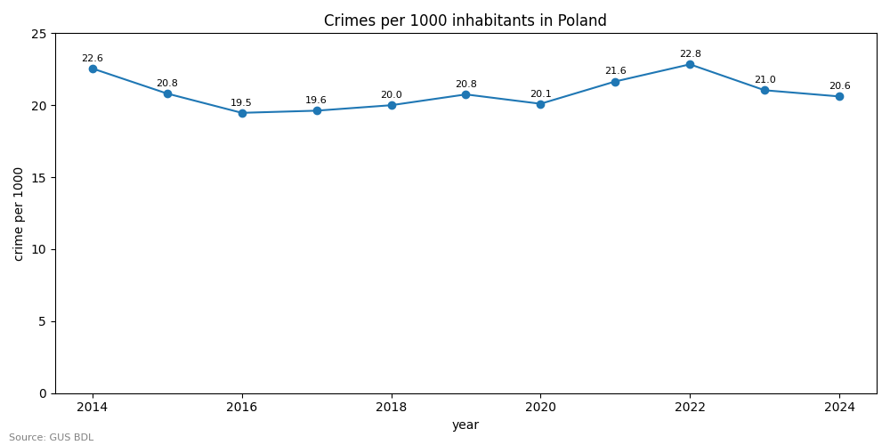
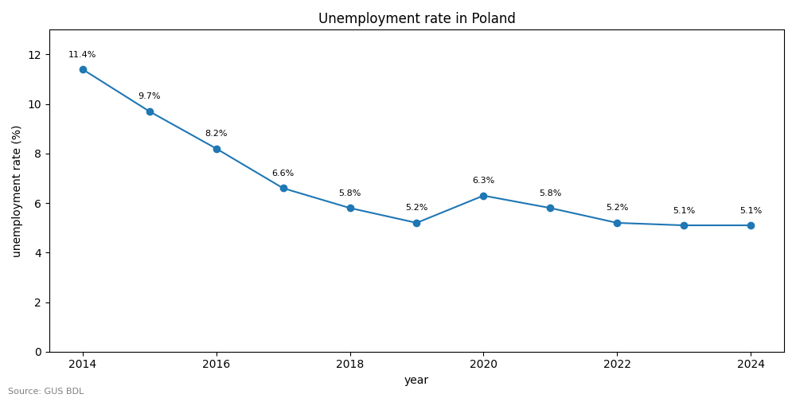
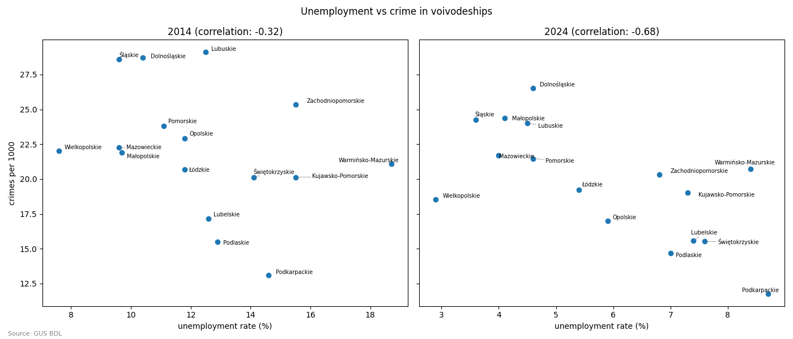
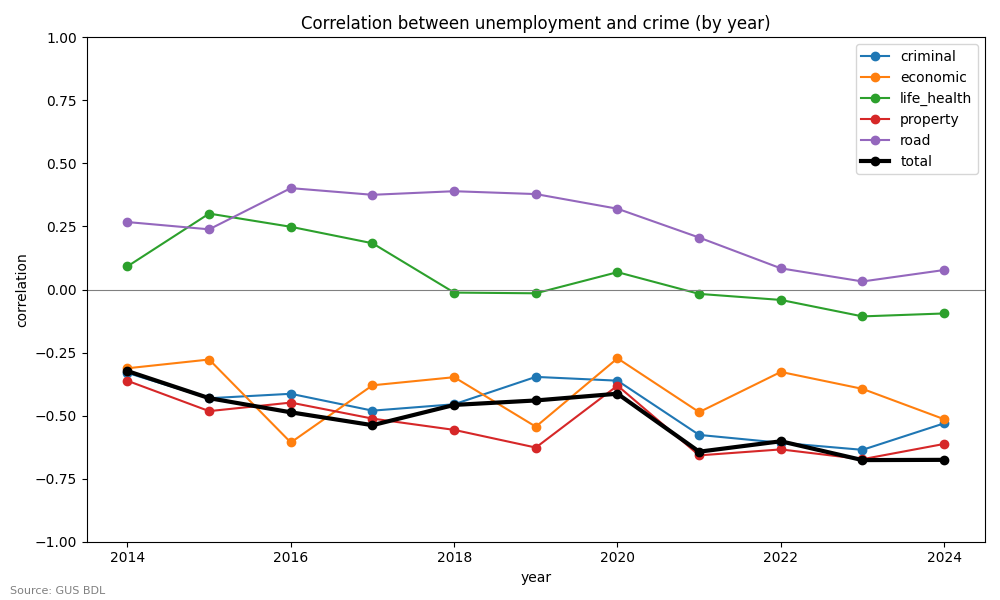
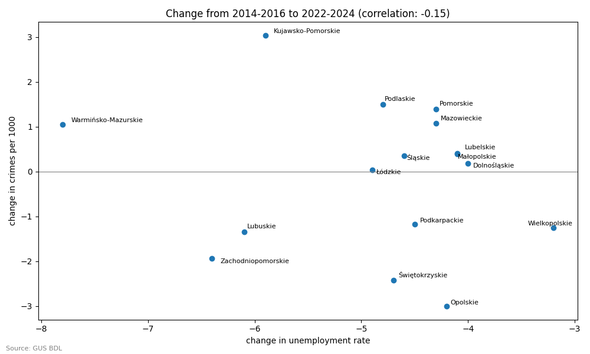
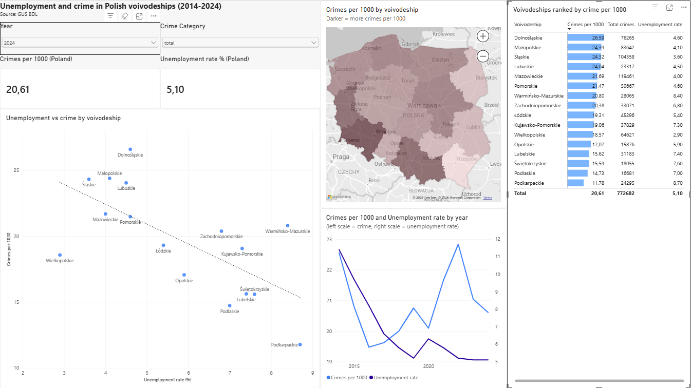

**English** | [Polski](README.pl.md)

# Unemployment and crime in Polish voivodeships (2014-2024)

Do voivodeships with higher unemployment also have more crime?
I checked this using official data from GUS for all 16 Polish voivodeships.

**Short answer:** no. In this data higher unemployment does not go together with more crime.
If anything, it's the opposite - but that is most likely because of other differences between regions,
not because of unemployment itself.

## Background

This topic started as a university project. In this version I wanted to look at it again in a different way:
I used crimes per 1000 inhabitants instead of numbers of crimes, compared voivodeships within one year
instead of over time, chose only years with the same way of counting crimes, and downloaded all the data
with the BDL API instead of collecting it from Excel files from the police and GUS websites.

## What I found

**1. Unemployment went down by more than half, but crime stayed almost the same.**
From 2014 to 2024 unemployment in Poland went down from 11.4% to 5.1%.
Crime per 1000 inhabitants stayed between about 19.5 and 23 the whole time.




**2. Voivodeships with higher unemployment have less crime, not more.**
The correlation between unemployment and crime is negative in every year, from -0.32 in 2014 to -0.68 in 2024.
Podkarpackie has the highest unemployment and the lowest crime, while Dolnośląskie, Śląskie and Małopolskie
have low unemployment and the most crime. A possible reason is that regions with big cities
have both more jobs and more chances for crime.



**3. Property crime shows this the most, road crime almost not at all.**
Thefts and burglaries are more common where unemployment is low.
Road crimes and crimes against life and health have almost no connection with unemployment.



**4. Changes over time don't match either.**
The voivodeships where unemployment went down the most didn't have a bigger drop in crime (correlation -0.15).



**5. Unusual values come from single types of crime.**
Śląskie in 2022 and Zachodniopomorskie in 2019 had one-year jumps in crime - in Śląskie from economic crime,
in Zachodniopomorskie from criminal offences. Małopolskie was the only voivodeship where crime was higher in 2024 than in 2014.

## Power BI dashboard

An interactive version of the analysis. You can choose the year and the crime category,
and all charts change: the map, the scatter plot (unemployment vs crime), the trend for Poland and the ranking.



The file is in `dashboard/`.

## Data

All data comes from the [GUS Local Data Bank (BDL)](https://bdl.stat.gov.pl/), downloaded with the BDL API.

| Data | Years used |
|---|---|
| Unemployment rate | 2014-2024 |
| Population | 2014-2024 |
| Crimes - total and 5 categories (criminal, economic, property, road, life and health), as number of crimes and per 1000 inhabitants | 2014-2024 |
| Unemployment rate and crime for the whole of Poland (to check my calculations) | 2014-2024 |

The data is published under the CC BY 4.0 licence.

### Why only 2014-2024?

The way the police count crimes changed a few times, so older and newer data can't be fully compared:

| Year | What changed |
|---|---|
| 2013 | Crimes from investigations led by the prosecutor's office and other bodies are no longer counted |
| 2014 | Crimes committed by minors are no longer counted |
| 2025 | The police changed the crime categories |

From 2013 to 2014 crime dropped by 15-22% in most voivodeships, much more than in other years, so I started from 2014. 
GUS also recalculated the population in 2021, so rates before and after 2020 can differ a little.

## How I did it

1. **Downloading** (`scripts/fetch_data.py`) - downloads all variables from the BDL API and saves them to `data/raw/`.
2. **Cleaning** (`notebooks/01_cleaning.ipynb`) - checks for missing values, chooses the years, makes two clean tables (unemployment and crimes) and checks the GUS rates against my own calculation.
3. **Analysis** (`notebooks/02_analysis.ipynb`) - trends for Poland, comparing voivodeships,
   correlations for every year and category, unusual values and change over 10 years.
4. **Dashboard** (`dashboard/`) - Power BI report built on the clean tables, with a star schema (voivodeship and year tables)
   and DAX measures that calculate the rates the same way as in the notebook.

A few things I had to be careful about:
- I use crimes **per 1000 inhabitants**, not the number of crimes, because big voivodeships have more crimes just because more people live there.
- I compare voivodeships **within one year**, because both unemployment and crime changed over time, and mixing the years could show a connection that comes only from time passing.
- The crime categories **overlap** (one crime can be in more than one category), so I never add them together.
- To get the rate for the whole country I add up all crimes and all people, instead of taking the average of the voivodeship rates.

## Project structure

```
unemployment-crime-poland/
├── data/
│   ├── raw/            # data downloaded from BDL
│   └── processed/      # clean tables used in the analysis
├── scripts/
│   └── fetch_data.py   # downloads the data from the BDL API
├── notebooks/
│   ├── 01_cleaning.ipynb
│   └── 02_analysis.ipynb
├── images/             # charts from the analysis
└── dashboard/          # Power BI dashboard
```

## How to run it

```
pip install -r requirements.txt
python scripts/fetch_data.py
```

Then open the notebooks in the `notebooks/` folder and run them in order.

## Tools

Python (pandas, numpy, matplotlib, requests), Jupyter Notebook, BDL API, Power BI